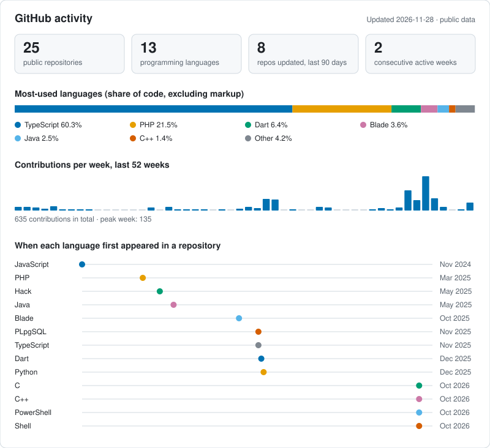

# Diki Alif Taufik

**Junior Software Engineer** · Bandung, Indonesia

[LinkedIn](https://www.linkedin.com/in/dikialiftaufik/) · [Portfolio](https://portfolio-dikialiftaufik.vercel.app/) · [GitHub](https://github.com/dikialiftaufik)

## Selected projects

| Project | What it does | Stack | Live |
| --- | --- | --- | --- |
| [**TaskGrader**](https://github.com/dikialiftaufik/task-grader) | Web platform that automatically grades object-oriented programming lab assignments (PDF reports and Java source code) using generative AI, with teaching-assistant review and student appeal flows. | TypeScript, PostgreSQL | [Demo](https://task-grader.vercel.app) |
| [**Harum Wastra**](https://github.com/dikialiftaufik/harum-wastra) | Storefront for aromatherapy candles made from used cooking oil. Visitors drop off oil, earn points, and redeem them for products. | Next.js, React, TypeScript, Tailwind CSS | [Demo](https://harum-wastra.vercel.app) |

## Activity

Generated daily from GitHub data ([how it is computed](docs/METRICS.md)). Percentages reflect share of code written, not proficiency.

<picture>
  <source media="(prefers-color-scheme: dark)" srcset="https://raw.githubusercontent.com/dikialiftaufik/dikialiftaufik/metrics/metrics.dark.svg">
  
</picture>
